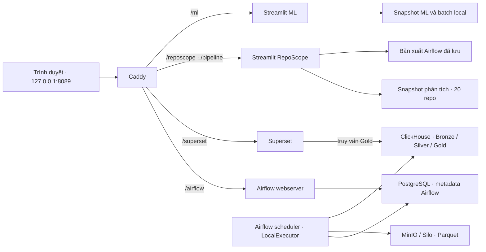
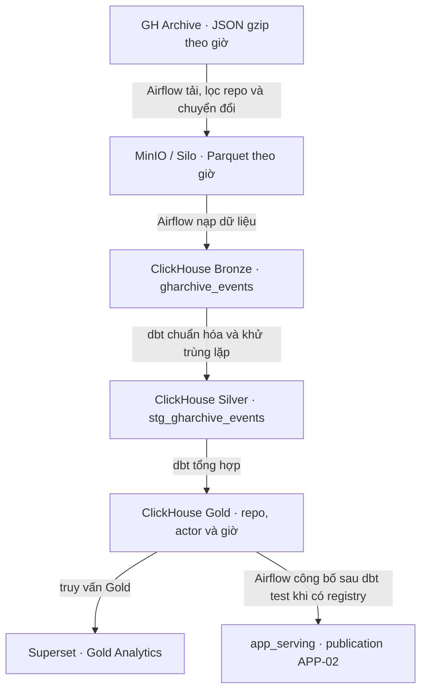

# RepoScope

RepoScope là đồ án chạy local để phân tích hoạt động GitHub và dự báo số lượt star mới trong 30 ngày cho 20 repo được theo dõi. Dữ liệu sự kiện lấy từ [GH Archive](https://www.gharchive.org/). Bản demo gồm Overview, Repository Explorer, Growth Analytics, Pipeline Health và đánh giá ML-03/04. APP-08 và APP-09 nằm trong [backlog mở rộng](docs/app-ml/plan.md).

## Chạy demo local

Chạy từ thư mục gốc repo với Docker Engine và Docker Compose hỗ trợ `!reset`.

```bash
docker compose -f docker-compose.yaml -f docker-compose.demo.yaml up -d --build
```

Trên Windows với Docker Engine cài trong Ubuntu WSL, chạy lệnh sau trong PowerShell tại cùng thư mục.

```powershell
wsl.exe -d Ubuntu -u root -e sh -lc '(docker info >/dev/null 2>&1 || service docker start) && docker compose --parallel 1 -f docker-compose.yaml -f docker-compose.demo.yaml up -d --build'
```

Lần đầu Docker tải và build các image. Airflow và Superset tiếp tục khởi tạo sau khi lệnh trả về. Mở [cổng demo](http://127.0.0.1:8089/) khi các dịch vụ đã sẵn sàng.

| Đường dẫn | Nội dung | Nguồn dữ liệu |
| --- | --- | --- |
| [`/reposcope`](http://127.0.0.1:8089/reposcope) | Overview, Explorer và Growth Analytics | Snapshot GH Archive của 20 repo |
| [`/ml`](http://127.0.0.1:8089/ml) | Đánh giá hồi cứu và dự báo lượt star 30 ngày | Kết quả holdout và batch tạo từ snapshot GH Archive |
| [`/airflow`](http://127.0.0.1:8089/airflow) | Điều phối và theo dõi DAG | Metadata của Airflow local |
| [`/superset`](http://127.0.0.1:8089/superset) | Dashboard GitHub Archive Gold Analytics | Gold của ClickHouse trong stack đang chạy |
| [`/pipeline`](http://127.0.0.1:8089/pipeline) | Pipeline Health trong RepoScope | Bản xuất Airflow đã lưu kèm hồ sơ nghiệm thu |

Caddy publish một cổng trên loopback. Có thể đặt `REPOSCOPE_DEMO_PORT` trong `.env` để đổi cổng mặc định `8089`. Tài khoản local mặc định là `airflow` / `airflow` cho Airflow và `admin` / `admin` cho Superset. Stack đọc các biến cấu hình trong [Compose gốc](docker-compose.yaml) và [Compose demo](docker-compose.demo.yaml).

### Kiểm tra và dừng

```bash
docker compose -f docker-compose.yaml -f docker-compose.demo.yaml ps -a
docker compose -f docker-compose.yaml -f docker-compose.demo.yaml logs --tail 40 airflow-scheduler superset demo-ml
docker compose -f docker-compose.yaml -f docker-compose.demo.yaml down
```

Trên PowerShell với Docker Engine trong Ubuntu WSL, thêm `wsl.exe -d Ubuntu -u root -e` trước các lệnh `docker compose` ở trên. `airflow-init`, `minio-init` và `demo-first-run` là các job khởi tạo một lần. `Exited (0)` là trạng thái thành công của các job này.

## Kiến trúc

### Topology dịch vụ local



### Luồng dữ liệu Medallion



Stack ghép Airflow 2.9.3 (LocalExecutor), PostgreSQL cho metadata, Silo tương thích S3, ClickHouse 24.3, dbt Core 1.8.8 với dbt-clickhouse 1.8.4, Superset 3.1.3, Streamlit và Caddy.

## Pipeline dữ liệu

DAG `gharchive_to_minio_hourly` hỗ trợ lịch theo giờ (`GHARCHIVE_DAG_SCHEDULE`, mặc định `@hourly`; đặt rỗng để chạy thuần backfill) và tắt catchup. Khi demo khởi động, `demo-first-run` nạp idempotent toàn bộ snapshot hợp nhất (`2025-01-01` → `2026-07-21` UTC) vào ClickHouse (`gold.gold_repo_daily_activity` cho Superset và `app_serving.*` theo hợp đồng APP-02), đồng thời xếp một lượt fetch trực tiếp cho **14:00 UTC ngày 15/01/2025** nếu run `reposcope-demo__2025-01-15T14` chưa tồn tại. Demo bật publication APP-02 bằng registry gồm 20 repo.

Để chạy lại một giờ cụ thể, mở [Airflow](http://127.0.0.1:8089/airflow), chọn DAG, bấm **Trigger DAG w/ config** rồi nhập:

```json
{
  "custom_date": "2025-01-15",
  "custom_hour": 14,
  "upload_raw_gz": false
}
```

Một giờ đủ cho ca kiểm tra ingest tới Gold. Một ngày chỉ có một tệp giờ vẫn là `provisional` theo APP-02. Growth 30 ngày cần hai kỳ 30 ngày đủ dữ liệu. RepoScope demo dùng snapshot đã đóng gói, còn Superset hiển thị Gold từ các run của stack.

## Dữ liệu và ML

| Bộ dữ liệu | Phạm vi và cách dùng |
| --- | --- |
| [Snapshot Hợp nhất RepoScope](ml/datasets/gharchive-2026-07-21/README.md) | **20 repo, 567 ngày từ `2025-01-01` đến `2026-07-21` UTC** (`563` ngày đủ 24/24 giờ, `1,79` triệu sự kiện, `103.964` lượt star), nối liền chặng 2025 (`2025-11-16`), holdout ML-03 (`2026-02-05`) và đợt backfill Airflow/ClickHouse Gold (`2026-02-06` → `2026-07-21`). Dùng làm nguồn mặc định cho RepoScope, ClickHouse/Superset (`demo-first-run`) và tab dự báo mới nhất trong Demo ML. |
| [Snapshot 2025](ml/datasets/gharchive-2025-11-16/snapshot/manifest.json) | 20 repo, từ 01/01 đến 16/11/2025 UTC, lấy từ commit `1e205c6c`. Các checkpoint giờ của đợt crawl nằm trên nhánh [`feature/ml-gharchive-backfill-checkpoints`](https://github.com/imnosuke/github_project/tree/feature/ml-gharchive-backfill-checkpoints). |
| [Holdout ML-03](ml/datasets/gharchive-2026-02-05/README.md) | 20 repo, 89 ngày và 2.136 tệp giờ từ 09/11/2025 đến 05/02/2026 UTC. Kèm phạm vi, độ phủ, checksum và kết quả đánh giá đã khóa. |
| [Batch ML-04](docs/app-ml/DEMO-defense.md) | Dùng 720 tệp giờ cuối của bộ holdout để dự báo cho 20 repo trong kỳ 06/02–07/03/2026 UTC. Container tạo batch khi khởi động lần đầu. |

ML-03 so sánh Persistence 30 ngày và Ridge Regression bằng hai holdout hồi cứu. Ở holdout gần nhất, MAE của Persistence là **28,07** và Ridge là **53,79** lượt star mỗi repo. ML-04 dùng Persistence. Đối chiếu batch với số star thực tế trong kỳ dự báo cho **MAE 42,85 lượt star/repo** và **WAPE 28,65%**. Xem [kết quả ML-03](docs/app-ml/ML-03-retrospective-results.md) và [phép đối chiếu ML-04](docs/app-ml/DEMO-defense.md#đối-chiếu-batch-ml-04-với-số-lượt-star-thực-tế).

### Chạy riêng demo ML

Trong môi trường Python 3.12, từ thư mục gốc repo:

```powershell
python -m pip install -r apps/streamlit/requirements.txt -r ml/requirements.txt
python -m ml.local_batch --output ml/runs/ml04-local.json
python -m streamlit run apps/streamlit/retrospective_demo.py --server.address 127.0.0.1 --server.port 8505
```

Nếu đã có `ml/runs/ml04-local.json`, chạy thẳng lệnh Streamlit để mở kết quả đã tạo. Đường dẫn `/ml` trong Compose dùng batch riêng trong container.

## Kiểm chứng và tài liệu

Lượt chạy Compose trên Ubuntu WSL đã xác minh cả năm đường dẫn trên cổng `8089`, gồm đăng nhập Airflow và Superset trên cùng cổng. Run fetch mẫu thành công và đối soát ClickHouse Gold ghi nhận **246 sự kiện, 12 lượt star và 6 lượt fork** trong ca kiểm tra.

```bash
python -m pytest apps/streamlit/tests ml/tests -q
python -m apps.streamlit.mvp_acceptance --source fixture
```

- [Hướng dẫn ứng dụng Streamlit](apps/streamlit/README.md)
- [Hướng dẫn ML và các lệnh audit](ml/README.md)
- [Nghiệm thu MVP bằng dữ liệu thật](docs/app-ml/APP-11-acceptance.md)
- [Pipeline, publication và đối soát Gold](docs/gharchive-streaming-staging.md)
- [Kịch bản demo đồ án](docs/app-ml/DEMO-defense.md)
